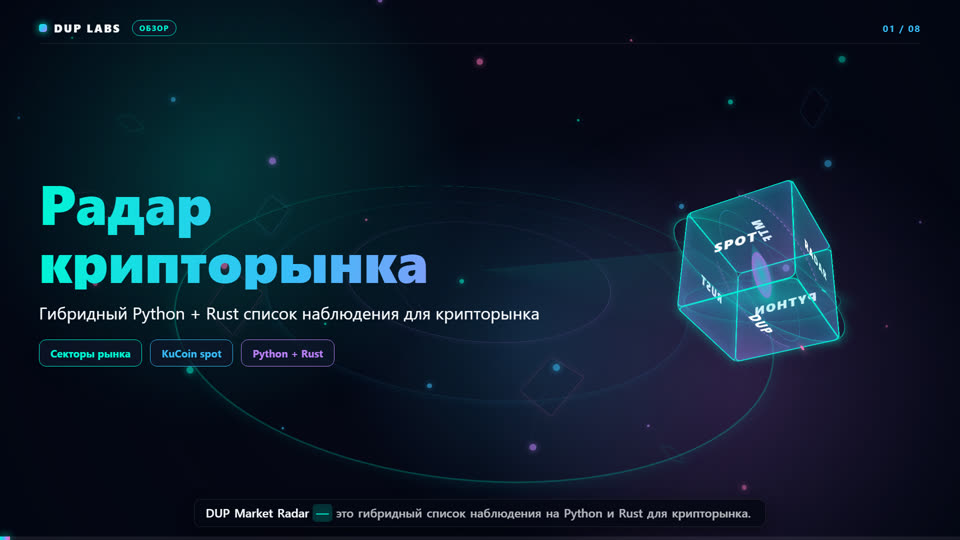

# DUP Presenter

**Declarative 3D Product Presentation Engine** (JSON deck → Edge TTS / Silero / Kokoro neural voice + SFX + music ducking → 3D Remotion slides with transitions & karaoke captions → broadcast −16 LUFS 1080p MP4 + Media QA Gate + Publish Pack).

Создаёт воспроизводимые продуктовые 3D-презентации (16:9 и 9:16) с живым кодом, скриншотами, 3D-архитектурой, KPI-метриками и честной проверкой фактов по исходникам репозитория — **без ручного видеомонтажа**.

## Демо

[](https://github.com/Gruver87/dup-presenter/releases/download/media-radar-showcase-v2/radar-showcase-v2.mp4)

Видео (1920x1080, 142 с, −16 LUFS, Media QA PASS) собрано этим пайплайном из деки [`decks/radar-showcase-v2.json`](decks/radar-showcase-v2.json). MP4 лежит в [GitHub Release `media-radar-showcase-v2`](https://github.com/Gruver87/dup-presenter/releases/tag/media-radar-showcase-v2), а не в git из-за лимита 100 МБ. В релизе есть субтитры `.srt/.vtt` и главы.

## Архитектура пайплайна

```text
decks/<slug>.json
   │
   ▼  python scripts/build_deck.py decks/<slug>.json --render
1. Fail-closed валидация схемы + опциональный Claim Audit (--audit-repo)
2. Озвучка RU (Edge TTS dmitry + офлайн-фолбэк Silero eugene) / EN (Kokoro am_michael)
   + STFT де-эссер + детектор речи для динамического дакинга музыки
   + пословные тайминги субтитров (SentenceBoundary + word alignment), стиль задаётся `caption_style`
   + процедурные SFX (transition whoosh + UI pop)
3. Рендер в Remotion 4 (TransitionSeries fade/slide/wipe + 3D-фон + ScreenWindow3D авто-зум)
4. Мастеринг звука в -16 LUFS / -1.5 dBTP (two-pass ffmpeg loudnorm)
5. Media QA Gate (ffprobe + LUFS + True Peak + dead-air check) -> out/<slug>_qa.json
6. Publish Pack: out/<slug>.srt/.vtt, _chapters.txt, _post_copy.md, _metadata.json, _thumb.png
```

## Презентация из Markdown (без JSON)

```powershell
# Пишем текст в examples/md-talk-demo.md, затем конвертируем в деку (fail-closed)
python scripts/md_deck.py examples/md-talk-demo.md --out decks/md-talk-demo.json
python scripts/build_deck.py decks/md-talk-demo.json --render
```

Поддерживаются типы `hero_3d`, `outro_3d`, `kpi`, `timeline`. Типы, которым нужны ассеты или символы кода, пишутся в JSON. Непонятная строка, неизвестный ключ или неподдерживаемый тип дают отказ с номером строки, файл не создаётся.

## Стили субтитров (`caption_style`)

- `box` (по умолчанию) — реплика целиком в плашке, как и раньше.
- `karaoke` — подсветка слов по ходу речи: текущее слово голубым, сказанные белым, ещё не сказанные приглушены. Тайминги слов, по приоритету: (1) русские голоса Edge (`WordBoundary`) отдают время каждого слова из TTS; (2) английские голоса (Kokoro, Silero EN) без событий движка получают тайминги локальным распознаванием `faster-whisper` (модель `base.en`, CPU) по собранному аудио; (3) если пакет не установлен, слова оцениваются по длине предложения и слова. Источник и доля совпавших слов пишутся в лог сборки. Для пункта (2) нужен `pip install faster-whisper` (модель загружается один раз). Каждая озвученная реплика получает слова, откат на `box` в собранных деках не происходит.
- `bold` — крупный белый текст с тенью, без плашки (для коротких вертикальных видео).

Демо: `decks/caption-karaoke-demo.json`, `decks/caption-bold-demo.json` и `decks/quote-demo.json` (с новым слайдом `quote`).

## Поддерживаемые шаблоны слайдов (`type`)

- `hero_3d` — титульный слайд с градиентом, бейджами и вращающимся 3D-кубом.
- `code_split` — split-screen: слева тезисы, справа 3D-окно кода с построчной анимацией.
- `screen_split` — split-screen с реальными скриншотами и виртуальной камерой авто-зума (`focus: {x, y, zoom}`).
- `arch_flow` — 3D-конвейер архитектуры с анимированными потоками пакетов.
- `kpi` — ключевые метрики (1–4 карточки).
- `timeline` — пошаговый пайплайн / дорожная карта (2–6 шагов).
- `terminal` — анимированный вывод терминала.
- `outro_3d` — финальный слайд со ссылкой, бейджами и 3D-кубом.
- `quote` — одна цитата в карточке (`title`, до 220 символов) с атрибуцией в `subtitle` (необязательно).

## Быстрый старт

```powershell
# Полная сборка + рендер + -16 LUFS + Media QA + Publish Pack
python scripts/build_deck.py decks/radar-pro.json --render

# Быстрый предпросмотр ОДНОГО слайда (секунды вместо минут)
python scripts/build_deck.py decks/radar-pro.json --only-slide s5 --render

# Снять по 1 PNG-кадру с каждого слайда без полного рендера MP4
python scripts/build_deck.py decks/radar-pro.json --preview-stills

# Строгий офлайн-режим (Privacy Lock: без сетевых TTS и стоков)
python scripts/build_deck.py decks/radar-pro.json --offline-only --render

# Аудит фактов де́ка по реальному репозиторию перед сборкой
python scripts/claim_audit.py decks/radar-pro.json --repo C:\path\to\repo

# Сделать вертикальный 9:16 Short (~50-60 сек) из 16:9 де́ка
python scripts/make_cutdown.py decks/radar-pro.json

# Перевести дек RU <-> EN (сохраняя код, числа и URL)
python scripts/translate_deck.py decks/radar-pro.json --to en

# Автосъёмка чистого UI через Playwright с координатами фокуса
python scripts/capture_ui.py --url http://127.0.0.1:8080 --out live_ui.png --focus-selector "table"

# Загрузить MP4 (>100 МБ) и пакет в GitHub Release
python scripts/github_release_uploader.py --mp4 out/radar-pro.mp4 --repo Gruver87/dup-presenter --dry-run

# Загрузить MP4 в черновики TikTok (Inbox)
python scripts/tiktok_uploader.py --mp4 out/radar-pro.mp4 --mode inbox

# Запустить локальную веб-консоль
python scripts/console_server.py --open

# Запустить MCP-сервер (stdio JSON-RPC 2.0 для Cursor / Claude)
python scripts/mcp_server.py
```

## Словарь произношения

Редактируется в `config/pronunciation.json` или через API консоли `GET/POST /api/pronunciation`.

## Что не публикуется

- `decks/dup-protocol.json` ссылается на скриншоты `public/screens/dup-protocol/`. Они в `.gitignore`: это снимки локальной консоли узла, и на них видны персональные данные владельца. На чистом клоне `deck_doctor` вернёт `missing screen file`, а рендер не начнётся (fail-closed). Деку можно собрать только на машине, где лежат эти файлы.
- `out/` (рендеры; например, `out/dup-protocol.mp4` собран из деки с этими скриншотами) и `public/ui_recordings/` (локальные записи UI) не коммитятся и не загружаются в Release.

## Тесты и проверки

```powershell
npx tsc --noEmit
python -m unittest discover -s tests -v

# Живая проверка веб-консоли в Chromium (нужна запущенная консоль на нужном порту)
python scripts/console_server.py --port 8790 --no-auto-ollama
python scripts/console_ui_check.py --url http://127.0.0.1:8790/
```

## Лицензии сторонних компонентов

- **Remotion**: бесплатная лицензия для физлиц и команд до 3 человек ([remotion.dev/docs/license/pricing](https://www.remotion.dev/docs/license/pricing)).
- **Silero TTS v5** (MIT), **Kokoro-82M ONNX** (Apache-2.0), **Edge TTS** (онлайн-сервис Microsoft).
- **Лицензия `dup-presenter`**: MIT (см. файл `LICENSE`). Это лицензия на код и шаблоны проекта, она не даёт прав на Remotion и другие сторонние компоненты.
- **Важно про Remotion**: его коммерческое использование регулируется отдельной лицензией Remotion. Перед коммерческим использованием проверьте [условия Remotion](https://www.remotion.dev/docs/license/pricing).
