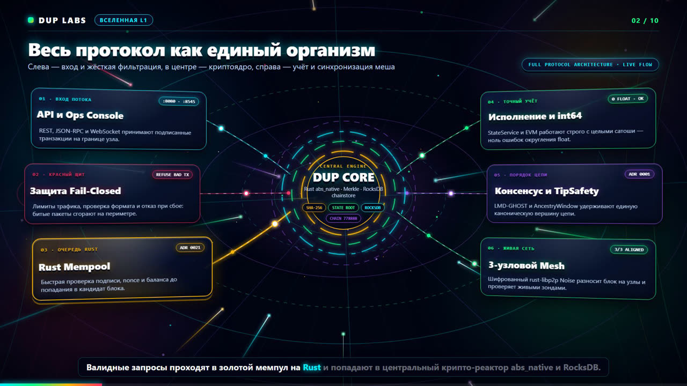
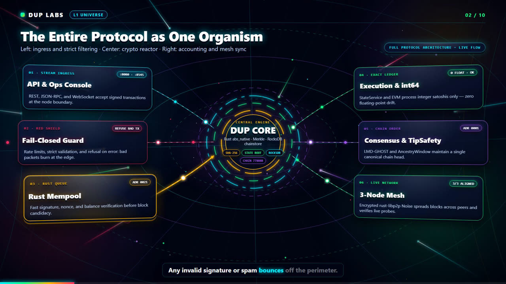

<p align="center">
  <a href="https://github.com/Gruver87">
    
  </a>
</p>

# DUP Presenter

[](https://github.com/Gruver87/dup-presenter/actions/workflows/ci.yml)
[](https://github.com/Gruver87/dup-presenter/releases/tag/v1.2.0)
[](LICENSE)
[](https://www.python.org/)
[](package.json)

**Declarative 3D Product Presentation Engine** by **DUP Labs** (JSON/Markdown deck → neural TTS + STFT de-esser + dynamic music ducking + word-level karaoke captions → Remotion 4 3D slides & cosmic themes → broadcast `−16 LUFS` 1080p/9:16 MP4 + fail-closed Media QA Gate + Publish Pack).

Создаёт воспроизводимые продуктовые 3D-презентации (16:9 и 9:16) с живым кодом, реальными скриншотами, записями UI, голографической 3D-архитектурой, KPI-метриками и проверкой фактов по исходникам репозитория — **без ручного видеомонтажа**.

---

## Демо-видео (GitHub Releases)

MP4-файлы не коммитятся в git (лимит 100 МБ) — готовые рендеры с субтитрами `.srt/.vtt`, главами и отчётами Media QA Gate публикуются в **GitHub Releases**:

### 1. DUP Protocol Cosmos (`quantum_ledger` · RU & EN)

| Русская версия (`229.4 с`, `−16.0 LUFS`, Edge Neural `dmitry`) | English version (`245.5 s`, `−16.06 LUFS`, Kokoro `am_michael`) |
|---|---|
| [](https://github.com/Gruver87/dup-presenter/releases/tag/media-dup-protocol-cosmos) | [](https://github.com/Gruver87/dup-presenter/releases/tag/media-dup-protocol-cosmos) |

- Деки: [`decks/dup-protocol-cosmos.json`](decks/dup-protocol-cosmos.json) (RU) и [`decks/dup-protocol-cosmos-en.json`](decks/dup-protocol-cosmos-en.json) (EN), тема `quantum_ledger`, 10 сцен, флагманский слайд `protocol_cosmos`, `ledger_layers`, `tx_journey`, `mesh_network`.
- Релиз с MP4, `.srt/.vtt`, `_chapters.txt` и `_qa.json`: [**`media-dup-protocol-cosmos`**](https://github.com/Gruver87/dup-presenter/releases/tag/media-dup-protocol-cosmos).

### 2. DUP Market Radar Showcase v2 (`142 с`, `−16 LUFS`, Media QA PASS)

[](https://github.com/Gruver87/dup-presenter/releases/download/media-radar-showcase-v2/radar-showcase-v2.mp4)

- Дека: [`decks/radar-showcase-v2.json`](decks/radar-showcase-v2.json) · Релиз: [**`media-radar-showcase-v2`**](https://github.com/Gruver87/dup-presenter/releases/tag/media-radar-showcase-v2).

---

## Архитектура пайплайна

```text
decks/<slug>.json  (или examples/*.md -> scripts/md_deck.py)
   │
   ▼  python scripts/build_deck.py decks/<slug>.json --render
1. Fail-closed валидация схемы + deck_doctor + опциональный Claim Audit (--audit-repo)
2. Озвучка RU (Edge TTS dmitry + офлайн Silero v5 eugene) / EN (Kokoro-82M v1.0 am_michael)
   + STFT де-эссер + детектор речи для динамического дакинга музыки
   + пословные тайминги субтитров (Edge WordBoundary RU / локальный faster-whisper ASR EN)
   + процедурные SFX (transition whoosh + UI pop)
3. Рендер в Remotion 4 (TransitionSeries fade/slide/wipe + 12 тем + 14 шаблонов 3D-слайдов)
4. Мастеринг звука в -16.0 LUFS / -1.5 dBTP (two-pass ffmpeg loudnorm, 48 kHz AAC 320 kbps)
5. Media QA Gate (ffprobe + LUFS + True Peak + dead-air check) -> out/<slug>_qa.json
6. Publish Pack: out/<slug>.srt/.vtt, _chapters.txt, _post_copy.md, _metadata.json, _thumb.png
```

Подробная схема и карта всех модулей: [**`docs/ARCHITECTURE.md`**](docs/ARCHITECTURE.md) · Полная схема де́ка: [**`docs/DECK_SCHEMA.md`**](docs/DECK_SCHEMA.md).

---

## 18 шаблонов слайдов (`type`)

| Шаблон | Описание |
|--------|----------|
| `hero_3d` | Титульный слайд с градиентом, цветными бейджами и вращающимся 3D-кубом (`backfaceVisibility: hidden`) |
| `protocol_cosmos` | Центральный вращающийся криптореактор, 6 вогнутых 3D-станций с оптоволоконными лучами и красным `fail-closed` щитом |
| `ledger_layers` | 3D-стек слоёв архитектуры (3–6 слоёв) с пошаговым фокусом и локализованной плашкой `ГАРАНТИЯ:` / `GUARANTEE:` |
| `tx_journey` | Жизненный цикл транзакции: сворачивание дерева Меркла, `prev_hash`-связка блоков и печать `SEALED ✓` |
| `mesh_network` | 3D-топология 3–4 узлов сети с импульсами распространения блока, зондами согласованности и карточками восстановления |
| `versus_split` | Сравнение **A vs B** (две дутые вогнутые 3D-колонки, пульсирующий центр `VS` и плашка `VERDICT`) |
| `chart_story` | Анимированные графики (`bar`, `line`, `donut`) с пружинным ростом значений и подписями |
| `stat_burst` | Динамический слайд-хук для первых 3–5 секунд (гигантская парящая цифра/тезис + энергетическое кольцо) |
| `broll_cinematic` | Полноэкранный кинематографичный слайд с Ken Burns, виньетированием и карточками-тезисами |
| `cinema_clip` | Полноэкранное видео без рамок и схем: `cinema.src` (MP4 под `public/`, длина считается через `ffprobe`, зацикливание под озвучку) или стоковый фон по `background_query`. Файл отсутствует — сборка падает (fail-closed) |
| `code_split` | Split-screen: слева тезисы, справа 3D-окно реального кода с построчной анимацией |
| `screen_split` | Split-screen с реальными скриншотами и виртуальной камерой авто-зума (`focus: {x, y, zoom}`) |
| `ui_recording` | Живая запись сценария UI через Playwright (`scripts/record_ui.py`) с авто-подгонкой длительности через `ffprobe` |
| `arch_flow` | 3D-конвейер архитектуры с анимированными потоками пакетов |
| `kpi` | Ключевые метрики (1–4 карточки; в `quantum_ledger` — дутые вогнутые полочки и парящие цифры) |
| `timeline` | Пошаговый пайплайн / дорожная карта (2–6 шагов) |
| `terminal` | Анимированный вывод терминала |
| `quote` | Цитата в 3D-карточке (`title`, до 220 символов) с атрибуцией в `subtitle` |
| `outro_3d` | Финальный слайд со ссылкой на репозиторий, бейджами, теглайном и 3D-кубом |

## Новые инструменты студии (Idea Engine, Presets, Thumbnail Studio, Video Pack)

```powershell
# A) Встроенный Генератор Идей (7 жанров, офлайн-шаблоны / Ollama / Cloud / DeepSeek, 1 шаг -> черновик де́ка)
python scripts/idea_engine.py --topic "Python vs Rust в 2026" --genre versus_battle --lang ru --write-first
# LLM-режимы fail-closed: --mode ollama (локально), --mode cloud (OPENAI_API_KEY или DEEPSEEK_API_KEY),
# --mode deepseek (нужен DEEPSEEK_API_KEY; модель DEEPSEEK_MODEL, по умолчанию deepseek-chat).
# Ключи только из переменных окружения; при ошибке провайдера шаблоны НЕ подставляются.
python scripts/idea_engine.py --topic "Большой взрыв" --lang ru --mode deepseek --write-first

# C) Генератор кликабельных обложек 1280x720 (Thumbnail Studio)
python scripts/thumbnail_studio.py --deck decks/dup-protocol-cosmos.json --badge "0 FLOAT · 48H PASS" --out out/cover.png

# D) Мультиформатная сборка Video Pack (16:9 + 9:16 Short + перевод + обложка + сводный QA-манифест)
python scripts/video_pack.py decks/radar-pro.json --translate-to en --preset cinema_cosmos --plan-only
```

## Студия в веб-консоли (`python scripts/console_server.py --open`)

Все функции опциональны; CLI (`build_deck.py`, `idea_engine.py`, `publish_pack.py`) работает как раньше.

| Вкладка | Что умеет |
|---|---|
| 01 · Новый ролик | Сборка из папки / GitHub; Idea Engine с опциональным веб-поиском свежих фактов (только LLM-режимы Ollama / Cloud) |
| 02 · Редактор | Drag-and-Drop картинок и видео (до 100 МБ) из Windows, по https-ссылке или из поиска по Wikimedia / NASA / Openverse прямо на слайд; Инспектор ассетов с лицензией (CC BY / CC BY-SA автоматически попадают в `_post_copy.md`); Таймлайн с перестановкой слайдов и прослушиванием озвучки; раскадровка и согласование мастера |
| 03 · Склейка | Несколько MP4 в один с выравниванием формата и звука |
| 05 · 3D Studio | Image-to-3D (Tripo3D / Fal.ai) и просмотр `.glb` в Three.js-вьюпорте (вращение, зум, сетка) |

Ключи — **только переменные окружения пользователя Windows**, не файлы в репозитории. Без ключа функция отказывает явно (fail-closed), подмены нет:

| Переменная | Для чего |
|---|---|
| `SERPER_API_KEY` или `BRAVE_API_KEY` | Веб-поиск для Idea Engine (Serper приоритетнее) |
| `TRIPO_API_KEY` или `FAL_KEY` | Генерация 3D-модели из картинки |
| `DUP_LLM_API_KEY` / `DEEPSEEK_API_KEY` / `OPENAI_API_KEY` | Cloud LLM для плана и идей |

```powershell
[Environment]::SetEnvironmentVariable("SERPER_API_KEY", "<ключ>", "User")
# консоль подхватывает новый ключ из реестра без перезапуска (обновите страницу);
# для CLI-скриптов откройте НОВОЕ окно PowerShell
```

Консоль слушает только `127.0.0.1` и отклоняет запросы с чужим `Host` (DNS rebinding) и cross-site POST из других вкладок браузера.

## 12 визуальных тем (`theme`)

Единый источник правды: `src/themes.ts` ↔ `scripts/theme_catalog.py`.

- **Тёмные:** `quantum_ledger` (вогнутая космическая 3D-воронка, 22 пучка транзакций, дутые полочки и парящий текст), `neon_cyber` (по умолчанию), `cosmic_radar`, `terminal_green`, `deep_ocean`, `sunset_orange`, `cyber_magenta`, `aurora_purple`, `mono_graphite`.
- **Светлые:** `minimal_light`, `paper_warm`, `corporate_blue`.

## Стили субтитров (`caption_style`)

- `box` (по умолчанию) — реплика целиком в аккуратной плашке.
- `karaoke` — пословная подсветка по ходу речи. Источники таймингов по приоритету:
  1. Русские голоса Edge TTS (`WordBoundary`) отдают точное время каждого слова из TTS.
  2. Английские голоса (Kokoro-82M, Silero EN) получают точные тайминги через локальное распознавание `faster-whisper` (`base.en`, CPU).
  3. Если ASR-пакет не установлен, слова оцениваются пропорционально длине, и в логе явно пишется `estimated` (честно, без подмены статуса).
- `bold` — крупный белый текст с тенью без плашки (для вертикальных 9:16 роликов).

---

## Презентация из Markdown (без JSON)

```powershell
python scripts/md_deck.py examples/md-talk-demo.md --out decks/md-talk-demo.json
python scripts/build_deck.py decks/md-talk-demo.json --render
```

Поддерживаются типы `hero_3d`, `outro_3d`, `kpi`, `timeline`. Непонятная строка, неизвестный ключ или неподдерживаемый тип дают fail-closed отказ с номером строки, файл не создаётся.

---

## Быстрый старт

```powershell
# Установка зависимостей
npm ci
pip install numpy scipy httpx playwright edge-tts kokoro-onnx faster-whisper

# Полная сборка + рендер + -16 LUFS + Media QA + Publish Pack
python scripts/build_deck.py decks/radar-pro.json --render

# Быстрый предпросмотр ОДНОГО слайда (секунды вместо минут)
python scripts/build_deck.py decks/radar-pro.json --only-slide s5 --render

# Снять по 1 PNG-кадру с каждого слайда без полного рендера MP4
python scripts/build_deck.py decks/radar-pro.json --preview-stills

# Строгий офлайн-режим (Privacy Lock: без сетевых TTS и стоков)
python scripts/build_deck.py decks/radar-pro.json --offline-only --render

# Аудит фактов де́ка по реальному репозиторию перед сборкой
python scripts/claim_audit.py decks/radar-pro.json --repo C:\path\to\repo

# Сделать вертикальный 9:16 Short (~50-60 сек) из 16:9 де́ка
python scripts/make_cutdown.py decks/radar-pro.json

# Перевести дек RU <-> EN (сохраняя код, числа и URL)
python scripts/translate_deck.py decks/radar-pro.json --to en

# Автосъёмка чистого UI / сценария через Playwright
python scripts/capture_ui.py --url http://127.0.0.1:8080 --out live_ui.png --focus-selector "table"
python scripts/record_ui.py scenarios/demo.json

# Запустить локальную веб-консоль (поддержка Markdown-импорта и выбора caption_style)
python scripts/console_server.py --open

# Запустить MCP-сервер (stdio JSON-RPC 2.0 для Cursor / Claude)
python scripts/mcp_server.py

# Опубликовать MP4 (>100 МБ) и Publish Pack в GitHub Release
python scripts/github_release_uploader.py --mp4 out/radar-pro.mp4 --repo Gruver87/dup-presenter --dry-run
```

## Словарь произношения

Редактируется в `config/pronunciation.json` или через API веб-консоли `GET/POST /api/pronunciation`.

## Что не публикуется в Git

- `decks/dup-protocol.json`, `decks/dup-protocol-story.json`, `decks/dup-protocol-cosmos.json` и `decks/dup-protocol-cosmos-en.json` ссылаются на локальные скриншоты `public/screens/dup-protocol/` (в `.gitignore`). На чистом клоне `deck_doctor` вернёт `missing screen file`, а рендер не начнётся (fail-closed).
- `out/` (рендеры MP4 и отчёты), `work/`, `public/voice/`, `public/music/`, `public/ui_recordings/`, `public/uploads/` (загрузки из консоли), `public/models3d/` (3D-модели), `models/` и `secrets/` не коммитятся в git.

## Тесты и проверки

```powershell
npx tsc --noEmit
python -m py_compile scripts/*.py
python -m unittest discover -s tests -v

# Живая проверка веб-консоли в Chromium (нужна запущенная консоль на нужном порту)
python scripts/console_server.py --port 8790 --no-auto-ollama
python scripts/console_ui_check.py --url http://127.0.0.1:8790/

# Живая проверка 3D-вьюпорта: загрузка реального .glb (нужен доступ к esm.sh для Three.js)
python scripts/glb_viewer_check.py --url http://127.0.0.1:8790/

# Аудит кнопок консоли: каждая видимая кнопка/чекбокс каждой вкладки нажимается один раз.
# POST/PUT/DELETE перехватываются и получают мок-ответ (ничего не публикуется и не пишется); отчёт: out/preview/click_audit.json
python scripts/console_click_audit.py --url http://127.0.0.1:8790/

# Резервная копия пользовательских данных вне git (decks, work/ с лицензиями, загрузки, 3D-модели; ключи не копируются)
powershell -ExecutionPolicy Bypass -File scripts\backup_user_data.ps1 -Destination "D:\DUP_backup"
```

Текущий статус CI: `npx tsc --noEmit`, `py_compile` и **324 Python unit/gate теста** (включая живой Playwright-тест записи UI) запускаются на каждом push/PR в [`.github/workflows/ci.yml`](.github/workflows/ci.yml). Python-зависимости для тестов закреплены в [`requirements-dev.txt`](requirements-dev.txt).

## Документация и экосистема DUP Labs

- **В этом репозитории:** [ARCHITECTURE.md](docs/ARCHITECTURE.md) · [DECK_SCHEMA.md](docs/DECK_SCHEMA.md) · [CHANGELOG.md](CHANGELOG.md) · [CONTRIBUTING.md](CONTRIBUTING.md) · [SECURITY.md](SECURITY.md) · [CITATION.cff](CITATION.cff)
- **Смежные репозитории DUP Labs:**
  - [`Gruver87/dup-protocol`](https://github.com/Gruver87/dup-protocol) — промышленный L1 audit-pin (Python + Rust)
  - [`Gruver87/dup-protocol-experimental`](https://github.com/Gruver87/dup-protocol-experimental) — R&D-песочница DUP Protocol
  - [`Gruver87/dup-market-radar`](https://github.com/Gruver87/dup-market-radar) — DUP Market Radar

## Лицензии сторонних компонентов

- **Лицензия `dup-presenter`**: MIT (см. [`LICENSE`](LICENSE)). Это лицензия на код и шаблоны проекта, она не даёт прав на Remotion и другие сторонние компоненты.
- **Отказ от ответственности**: программа предоставляется «как есть». Ответственность за контент, права на визуалы, ключи и соблюдение правил платформ несёт пользователь. См. [`DISCLAIMER.md`](DISCLAIMER.md).
- **Remotion**: бесплатная лицензия для физлиц и команд до 3 человек ([remotion.dev/docs/license/pricing](https://www.remotion.dev/docs/license/pricing)). Перед коммерческим использованием проверьте условия Remotion.
- **Silero TTS v5** (MIT), **Kokoro-82M ONNX** (Apache-2.0), **faster-whisper** (MIT), **Edge TTS** (онлайн-сервис Microsoft).
